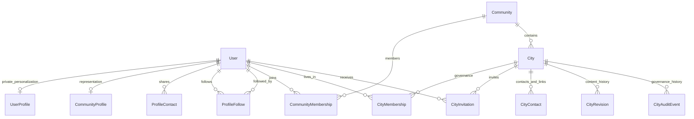

# Domain model

Community: slug unique, name/descriptions, logo/cover URLs, active/archived,
public/community/private visibility and timestamps.

CommunityMembership: unique (user, community), pending/active/left/suspended,
member/moderator/admin role, joined/updated dates. Reactivation reuses a row.

CommunityProfile: user one-to-one, display_name, bio, avatar_url, opt-in
profile visibility, Minecraft/social/ITMO/membership visibility. Existing
Minecraft/VK/ITMO values continue to come from core.UserProfile. Email, ISU,
license, account status and security never occur in the public schema.

ProfileFollow: directed user → target, unique pair, database no-self constraint,
created_at. ProfileContact: unique (user, type), Discord/Telegram/VK, bounded
provider-validated value and private-by-default visibility. Both cascade on
account deletion. CommunityProfile.connections_visibility controls exposure of
the communication circle and defaults to private. Following grants no extra
access. See [player connections](player-connections.md) for list privacy rules.

City: community FK, globally unique stable lowercase slug, name, summary,
Markdown description, draft/active/archived, open/limited/closed recruitment,
founded date, region/language/how-to-join, logo/cover, optional atomic
world/x/y/z/map_id location, external marker reference, version/timestamps.
No owner column. No PostGIS. X/Z must both exist or both be absent.

CityMembership: unique (user, city), pending/active/left/removed,
resident/representative/manager, human position, public/community/private
visibility, joined/left timestamps. ACTIVE city membership requires ACTIVE
community membership. Moderation explicitly establishes membership during
city creation; ordinary invitations require existing community members and recipient consent.
Database choices, uniqueness and coordinate constraints back service checks.
Membership responses distinguish relationship `status` from `city_status`;
archived relationships remain in private data/history and are omitted from current city cards.

CityContact: new writes allow Discord invitations/Telegram/VK, label, provider-checked HTTPS URL,
visibility, sort_order. Ordered repeatable editor, bounded list length.

CityRevision: immutable version, actor SET_NULL, timestamp, full typed city
content snapshot, changed field names. CityAuditEvent: immutable actor
SET_NULL, action, city, target membership identifier, changed fields,
before/after role/status/position/visibility and override reason. No private
identity snapshots.

Indexes: city lifecycle/community; memberships user/status and city/status/role;
history city/time. Counts are database aggregates; leadership is prefetched.

CityInvitation: city/user, nullable inviter, pending/accepted/declined/revoked,
created/expires/responded timestamps. Unique pending (city, user), 14-day expiry,
recipient-only response. Accept/revoke races serialize on user then city locks;
accept rechecks city/community eligibility and creates or reactivates the unique
resident membership. Transitions audit inside the transaction.

Legacy website/other contacts remain readable in revision snapshots and stored
data; changing a contacts collection requires converting/removing those entries.

Profile social additions: friends are reciprocal ProfileFollow rows, never a
second relationship table or permission source. Non-mutual inbound followers
and mutual friends are disjoint; outgoing subscriptions retain both.
`profiles/0004` adds minecraft_first_joined_at with the user-approved baseline
2026-01-01 for existing/new profiles. A future server import replaces this value;
website date_joined is unrelated. The derived server_history read schema uses
Minecraft visibility and backend Russian number agreement. No self-edit API.
