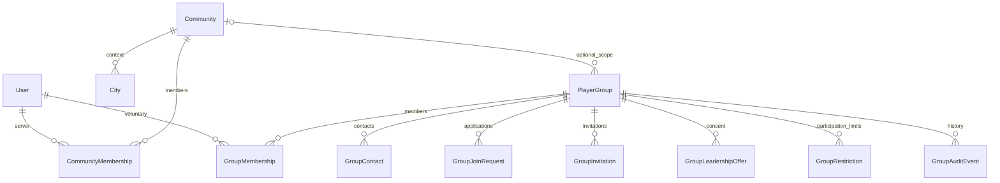

# Объединения игроков: модель и API

Реализация опирается на [ADR](adr-001-community-groups.md) и оба агентских
документа от 21.09.2026. Рабочая версия остаётся локальной, под флагами.

## Домены

`Community` / `CommunityMembership` — прежнее доверенное участие в сервере.
Добавлены только необязательные enrollment_text и enrollment_url. Старые связи,
UserProfile, персонализация, города, друзья и настройки приватности сохраняются.
Новые `PlayerGroup` / `GroupMembership` живут в отдельном app `playergroups`.
Ни создание клуба, ни вступление в него не дают серверное участие и городские роли.

Slug уникален глобально и не меняется; scope после создания не переносится.
Человек может участвовать в нескольких группах. Пара user/group уникальна;
повторное вступление использует ту же запись, сохраняет first_joined_at и
обновляет joined_at текущего участия. Роль не восстанавливается после выхода.

## Состояния и переходы

| Измерение | Значения | Поведение |
| --- | --- | --- |
| Публикация | draft / active / archived | Черновик доступен участникам/оператору; архив исключён из общего каталога |
| Доступ | public / unlisted / private | Unlisted доступно любому по ссылке; private только участникам |
| Вступление | open / approval / invite_only | Private допускает только invite_only |
| Набор | accepting / paused | Пауза запрещает вступление и принятие заявок/приглашений, но допускает отказы и выход |
| Участие | active / left / removed | Удаление из состава само по себе не запрещает новое вступление |
| Ограничение участия | active + optional until | Запрещает вступление, заявку и принятие приглашения; снятие не возвращает роль |
| Заявка | pending → accepted / rejected / cancelled / expired | Отозвать может только автор, принять/отклонить — уполномоченный организатор |
| Приглашение | pending → accepted / declined / revoked / expired | Согласие требуется от адресата; членство появляется только после принятия |
| Предложение руководства | pending → accepted / declined / revoked / expired | До согласия нет роли manager; передача атомарно понижает отправителя |

Архив закрывает незавершённые процессы. Восстановление не оживляет их и оставляет
набор на паузе. Истечение вычисляется и на чтении, без записи из GET. Мутации
закрывают истёкшие процессы в своей транзакции. Потеря полномочий отправителем
аннулирует его приглашения/предложения. Все отклики повторно проверяют текущее
состояние и scope; клиентская кнопка не является проверкой разрешений.

Повторное принятие/вступление не создаёт вторую связь, не меняет joined_at и не
создаёт повторный аудит. При совпадении заявки и приглашения успешное вступление
закрывает оба. После отклонения заявки — сутки до повторной подачи; после отказа
от приглашения — по умолчанию семь дней до нового приглашения.

## Приватность и разрешения

Матрица ролей находится в ADR. Platform moderator — permission
`playergroups.moderate_playergroup`; `is_staff` и роль в городе его не заменяют.
Проверка платформенного разрешения читает актуальную БД, а не кеш User.has_perm.

Три разных настройки: доступ к странице, видимость состава, личная видимость
участия. Новая личная связь private. Обычный список показывает только разрешённые
профили и подпись «Открытые профили»; скрытый список возвращает `total: null`.
Управленческий состав показывает минимальный username для адресации, роль и
состояние, разрешённые Minecraft nick/avatar. Email, ISU и закрытые контакты
не сериализуются. Клуб никогда не расширяет прежнюю аудиторию `community` профиля.
Скрытый серверный контекст не раскрывается через краткую карточку группы.

Приглашение в private-группу даёт адресату только краткое предложение и условия:
без состава, закрытого описания, приветствия и контактов. Полная страница до
принятия остаётся 404. Личные ответы и служебная история не входят в публичные
схемы. Все новые group/account/profile ответы — private/no-store.

В личной истории членство хранится отдельно от текущих сведений группы.
После утраты доступа к закрытой странице API возвращает `group: null`: бывший
участник видит свой статус, но не новое описание, название, оформление или ссылку.

Markdown рендерится существующим SafeContent без raw HTML. Контакты допускают
только HTTPS Discord, Telegram и VK по существующим allowlists. Картинки идут
через прежний проверяемый media upload; их URL не является закрытым хранилищем.

## API

OpenAPI — источник схем, ограничений строк, enum и ошибок. Бизнес-переходы в
services/participation/invitations/leadership/membership_service; transport
разделён на небольшие routers в `playergroups/api/`. Все коллекции групп и
процессов имеют страницу до 24 элементов; queries используют пакетные политики
и выборки. Ограничение числа запросов проверяется тестами.

| Путь после /api | Методы и назначение |
| --- | --- |
| /groups | GET каталог q/scope/category/join_mode/page; POST черновик |
| /groups/{slug} | GET страница; PATCH известные поля с version |
| /groups/{slug}/lifecycle | POST publish/archive/restore с version |
| /groups/{slug}/images | POST прежний валидируемый upload |
| /groups/{slug}/people | GET разрешённый публичный состав |
| /groups/{slug}/members | GET служебный состав, history/page |
| /groups/{slug}/join, /leave | POST добровольное вступление/выход |
| /groups/{slug}/membership | PATCH личная visibility |
| /groups/{slug}/members/{id} | PATCH только member/moderator |
| /groups/{slug}/members/{id}/remove, /restriction | POST завершение участия/ограничение с основанием |
| /groups/{slug}/requests | POST заявка |
| /groups/{slug}/requests/{id}/decision, /withdraw | POST решение/отзыв |
| /groups/{slug}/invitations | POST приглашение по username |
| /groups/{slug}/invitations/{id}/revoke | POST отзыв |
| /groups/{slug}/leadership, /leadership/{id}/revoke | POST предложение/отзыв руководства |
| /groups/{slug}/processes | GET kind=request/invitation/leadership + page |
| /groups/{slug}/history | GET история для руководства и платформы |
| /account/server-communities | GET все личные серверные состояния |
| /account/groups | GET текущие группы или history |
| /account/group-processes | GET свои предложения, заявки и результаты |
| /account/group-invitations/{id}, /group-leadership/{id} | POST согласие/отказ адресата |
| /account/group-requests/{id}/withdraw | POST собственный отзыв даже после закрытия страницы |
| /profiles/public/{username}/groups | GET разрешённые связи профиля |
| /moderation/groups | GET список для платформы |
| /moderation/groups/{slug}/restriction, /recovery | POST ограничение/предложение восстановления с основанием |

Ошибки имеют стабильный `GROUP_*` код: NOT_FOUND, PERMISSION_DENIED,
LAST_MANAGER, VERSION_CONFLICT, PROCESS_CLOSED, JOIN_PAUSED, SCOPE_REQUIRED,
PARTICIPATION_RESTRICTED, SLUG_CONFLICT, WRITES_PAUSED и ограничители частоты.
Фронтенд использует capabilities и показывает серверное объяснение ошибки.
Конфликт версии сохраняет введённый текст; смена раздела с черновиком требует
подтверждения. История загружается только при открытии раздела.

## Жизненный цикл и аудит

Мутации сериализуются блокировкой группы, предварительные User locks берутся
по pk. PostgreSQL проверяет одновременные join, выход руководителей, принятие
приглашения/архив. Ограничения БД проверяют enum, private/invite_only и уникальные
pending-процессы. Все значимые изменения и аудит записываются в одной транзакции.
История хранит действие, actor/target (nullable), process id, изменённые поля,
основание и platform_override. Чувствительные payload не пишутся в application log.

Последний руководитель сначала передаёт роль или архивирует группу; правило
учитывается при удалении аккаунта. Деактивация аккаунта, утрата/удаление серверного
участия или архивация scope снимают групповые роли; возвращение scope их не
воскрешает. Группа без руководства ограничивается. Оператор может предложить
восстановление подходящему игроку; членство/руководство появляются только после
его согласия. После восстановления набор остаётся на паузе.

Управленческие Django Admin разделы предназначены для просмотра; прямое
редактирование ролей/процессов там выключено, чтобы не обходить сервисы.
QuerySet.update, bulk writes и прямой SQL не являются поддерживаемым интерфейсом
governance. Для пользовательских операций используются доменные сервисы.

## Сознательно отложено

Нет чата, ленты, внешних уведомлений, общих invite links, членских взносов, событий,
задач и синхронизации Discord/Minecraft. Официальное server enrollment остаётся
прежним доверенным процессом: страница объясняет его и может содержать проверенную
ссылку, но не имитирует подтверждение доступа к серверу. Нет переноса scope,
произвольных ролей, гранулярного ACL и автоматического восстановления старых ролей.
